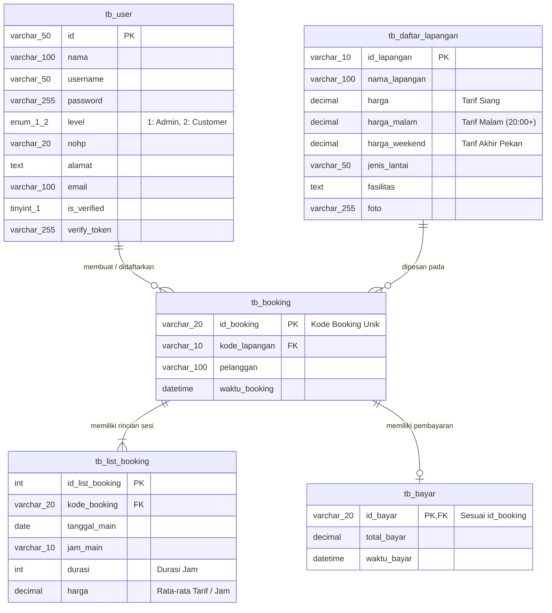

# ⚽ Aplikasi Pemesanan Lapangan Futsal (Alouh Futsal)

Dokumentasi spesifikasi produk dan panduan teknis implementasi aplikasi web pemesanan lapangan futsal berbasis **Next.js 15+ (App Router)**, **React 19**, **Tailwind CSS**, dan **MySQL Database (`db_alouhfutsal`)**.

---

## 📌 1. Ringkasan Produk

Aplikasi web responsif yang dirancang untuk memudahkan pelanggan memesan dan membayar sewa lapangan futsal secara *real-time* 24 jam, sekaligus menjadi pusat kendali bagi pengelola (Admin) dalam memantau ketersediaan slot jadwal, verifikasi transaksi pembayaran, pencatatan master lapangan, dan pelaporan pendapatan.

- **Nama Proyek:** Alouh Futsal Booking System
- **Platform:** Web Responsif (Desktop, Tablet, dan Mobile)
- **Target Pengguna:** 
  - **Admin (Level 1):** Pengelola / Kasir Tempat Futsal
  - **Customer (Level 2):** Pelanggan / Perwakilan Tim
- **Nilai Utama:**
  - 🚫 **Bebas Double Booking:** Validasi ketersediaan jadwal terintegrasi untuk mencegah bentrok slot antar pemesan.
  - ⚡ **Pemesanan Cepat Langsung di Kalender:** Modal booking instan langsung dari halaman jadwal tanpa perlu berpindah-pindah menu.
  - 💰 **Diferensiasi Tarif Siang & Malam:** Kalkulasi biaya otomatis berdasarkan jenis lapangan dan jam main.
  - 🧾 **Faktur & Laporan Keuangan:** Cetak invoice instan (tiket booking) dan ekspor laporan transaksi ke format Excel (CSV).

---

## 🎯 2. Masalah yang Diselesaikan & Target Keberhasilan (PRD Alignment)

| Masalah Konvensional | Solusi Sistem di Aplikasi Ini | Target Metrik PRD | Status di Project |
| :--- | :--- | :--- | :---: |
| **Jadwal Bentrok (Double Booking)** | Pengecekan slot unik (*unique check*) di database sebelum transaksi disimpan | **0** bentrok / bulan | ✅ Terimplementasi |
| **Pemesanan Manual Lewat Chat** | Grid slot kalender ketersediaan interaktif dengan modal reservasi instan | Waktu pesan **< 2 menit** | ✅ Terimplementasi |
| **Verifikasi Pembayaran Lambat** | Multi-metode: Bayar Cash oleh Kasir dan Online Transfer / Midtrans Gateway | Verifikasi **< 30 menit** | ✅ Terimplementasi |
| **Rekap Pendapatan Manual** | Dashboard analitik pendapatan dan Laporan Keuangan dengan ekspor CSV/Excel | **100%** otomatis | ✅ Terimplementasi |
| **Kecepatan Akses** | Next.js Server Components (SSR) & Server Actions cepat | Waktu muat **< 3 detik** | ✅ Terimplementasi |

---

## 👥 3. Peran Pengguna & Hak Akses (RBAC)

Aplikasi menerapkan kontrol akses berbasis peran (*Role-Based Access Control*) yang diverifikasi di sisi server (`tb_user.level`):

### 1. Customer (Level 2)
- Melihat katalog lapangan beserta fasilitas, foto, jenis lantai, dan tarif siang/malam di Dashboard.
- Mengecek ketersediaan jadwal slot harian secara langsung.
- Melakukan booking slot lapangan dengan formulir cepat (nama pemesan, durasi sewa, perkiraan biaya).
- Melakukan pembayaran tagihan pesanan via transfer online (Midtrans Snap).
- Melihat riwayat transaksi dan mencetak/mengunduh tiket invoice resmi.

### 2. Admin (Level 1)
- **Dashboard Ringkasan:** Statistik pendapatan total, transaksi selesai, dan jumlah pelanggan.
- **Master Data Lapangan:** CRUD (Tambah, Edit, Hapus, Upload Foto) data lapangan beserta tarif siang, malam, dan weekend.
- **Kelola Jadwal & Booking Walk-in:** Menambah jadwal booking manual, mengedit jadwal, atau membatalkan sesi.
- **Verifikasi Pembayaran:** Konfirmasi pembayaran tunai (Cash) di kasir maupun cek status online.
- **Manajemen Pengguna:** Manajemen data customer, reset password, dan status verifikasi akun.
- **Laporan Keuangan:** Histori transaksi lunas, ringkasan pendapatan bulan berjalan, dan tombol Export Excel (CSV).

---

## ⏰ 4. Aturan Bisnis & Struktur Tarif Operasional

### A. Jam Operasional Slot
- **Sesi Siang (Reguler):** `08:00` s/d `17:00` WIB
- **Jeda Waktu Maghrib / Istirahat:** `18:00` dan `19:00` WIB (**Dihapus dari daftar booking**)
- **Sesi Malam:** `20:00` s/d `23:00` WIB

### B. Daftar Tarif Sewa Lapangan
| Lapangan | Jenis Lantai | Tarif Siang (08:00 - 17:00) | Tarif Malam (20:00+) |
| :--- | :--- | :---: | :---: |
| **Lapangan Rumput** | Rumput Sintetis | **Rp 100.000** / jam | **Rp 120.000** / jam |
| **Lapangan Fiber** | Vinyl / Fiber | **Rp 120.000** / jam | **Rp 150.000** / jam |

> *Catatan:* Perhitungan harga secara otomatis diterapkan saat pemesan memilih jam main di modal jadwal maupun saat kasir menambahkan sesi jadwal di halaman booking item.

### C. Batas Waktu & Kedaluwarsa Booking
- Pesanan yang belum lunas setelah melebihi 15 menit dari `waktu_booking` akan berstatus **KEDALUWARSA** pada indikator kalender jadwal, memberi ruang bagi pemesan lain.

---

## 🗄️ 5. Skema Struktur Database Aktual (`db_alouhfutsal`)

Database menggunakan engine **MySQL (InnoDB)** dengan 5 tabel utama:



---

## 🛠️ 6. Teknologi & Pustaka yang Digunakan

- **Core Framework:** Next.js 15+ (React 19, Server Actions, Dynamic Routing)
- **Database Engine:** MySQL 8 (`mysql2/promise` dengan Connection Pool)
- **Styling & Icons:** Tailwind CSS & Lucide React
- **Komponen Interaktif & Alert:** SweetAlert2
- **Payment Gateway:** Midtrans Snap SDK (`midtrans-client`)
- **Email Service:** Nodemailer (SMTP Gmail untuk verifikasi akun customer)
- **ID Generator:** UUID & Date-based unique booking code

---

## 🚀 7. Panduan Menjalankan Proyek Secara Lokal

### Prasyarat
- **Node.js** v18+ atau v20+
- **MySQL Database Server** (XAMPP / Laragon / MySQL Server aktif)
- Database **`db_alouhfutsal`** telah dibuat dan diimpor.

### Langkah Menjalankan

1. **Pastikan MySQL Aktif:**
   Pastikan service MySQL berjalan pada port `3306`. Koneksi database diatur di `src/lib/db.js`:
   ```javascript
   host: 'localhost',
   user: 'root',
   password: '',
   database: 'db_alouhfutsal'
   ```

2. **Konfigurasi Environment Variables (`.env`):**
   Pastikan file `.env` di root direktori memiliki konfigurasi berikut:
   ```env
   # SMTP Email untuk Verifikasi Registrasi (Opsional jika menggunakan Gmail App Password)
   SMTP_HOST=smtp.gmail.com
   SMTP_PORT=465
   SMTP_SECURE=true
   SMTP_USER=your_email@gmail.com
   SMTP_PASS=your_app_password

   # URL Aplikasi
   NEXT_PUBLIC_APP_URL=http://localhost:3000
   ```

3. **Instal Dependensi (Jika baru clone):**
   ```bash
   npm install
   ```

4. **Jalankan Aplikasi:**
   ```bash
   npm run dev
   ```
   Buka peramban di [http://localhost:3000](http://localhost:3000).

---

## 📂 8. Peta Struktur File Proyek

```text
Aplikasi Booking Futsal/
├── public/
│   ├── assets/img/            # Foto-foto lapangan futsal (Rumput, Fiber, dsb)
│   └── login-bg.png           # Aset visual hero / background
├── src/
│   ├── app/
│   │   ├── (admin)/           # Rute Panel Dashboard & Manajemen
│   │   │   ├── booking/       # Kelola data booking & transaksi
│   │   │   │   └── [id]/      # Kelola sesi jam, rincian, & pembayaran (Cash / Online)
│   │   │   ├── dashboard/     # Tampilan statistik kasir & katalog kartu lapangan
│   │   │   ├── jadwal/        # Kalender ketersediaan waktu & pop-up modal booking
│   │   │   ├── lapangan/      # Master data lapangan & tarif (Siang, Malam 20:00+)
│   │   │   ├── report/        # Rekap pendapatan & tombol Export Excel (CSV)
│   │   │   ├── user/          # Manajemen data pelanggan & level akun
│   │   │   └── layout.jsx     # Sidebar admin & navigasi utama
│   │   ├── api/               # API endpoint Next.js
│   │   ├── invoice/[id]/      # Cetak invoice / tiket booking resmi
│   │   ├── login/             # Halaman login multi-peran
│   │   ├── register/          # Halaman registrasi akun customer
│   │   ├── verify/            # Halaman verifikasi email akun
│   │   ├── globals.css        # Styling tema global
│   │   └── layout.js          # Root layout
│   └── lib/
│       ├── db.js              # Koneksi Pool MySQL database
│       └── session.js         # Pengelolaan session pengguna terenkripsi
├── PRD Aplikasi Pemesanan Lapangan Futsal.docx # Dokumen PRD acuan
└── README.md                  # Dokumentasi proyek lengkap ini
```

---

## 📋 9. Status Kepatuhan PRD & Rencana Lanjutan

- [x] **Katalog Lapangan & Tarif:** Pengaturan tarif dasar (siang) dan malam ($20:00+$) serta foto lapangan.
- [x] **Jadwal & Ketersediaan:** Grid visual per jam dengan warna status (Tersedia, Terisi Lunas, Menunggu, Kedaluwarsa).
- [x] **Pemberhentian Slot Maghrib:** Jam 18:00 dan 19:00 dinonaktifkan dari pilihan slot.
- [x] **Pemesanan Cepat (Modal):** Pengguna dapat langsung memesan slot tanpa keluar dari kalender jadwal.
- [x] **Pilihan Pembayaran:** Pembayaran tunai (Kasir) & Payment Gateway Midtrans Snap.
- [x] **Faktur & Laporan Keuangan:** Tiket cetak invoice PDF/Print dan ekspor laporan transaksi ke Excel/CSV.
- [ ] *Kandidat Pengembangan Lanjutan:* Fitur kupon/voucher diskon dan ulasan/rating lapangan pasca bermain.
